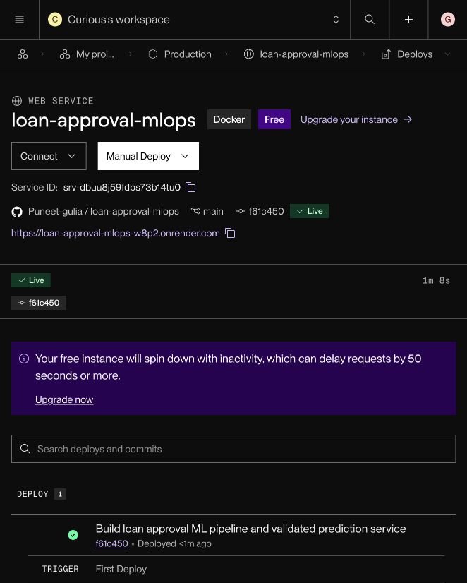
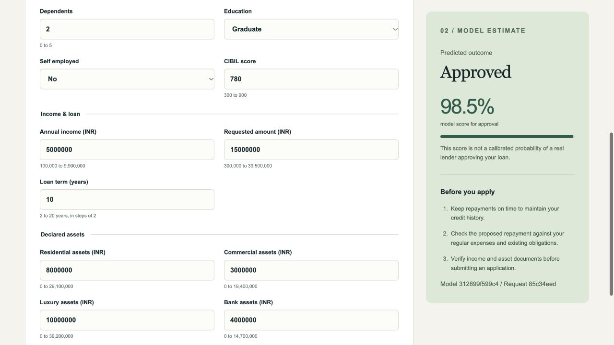
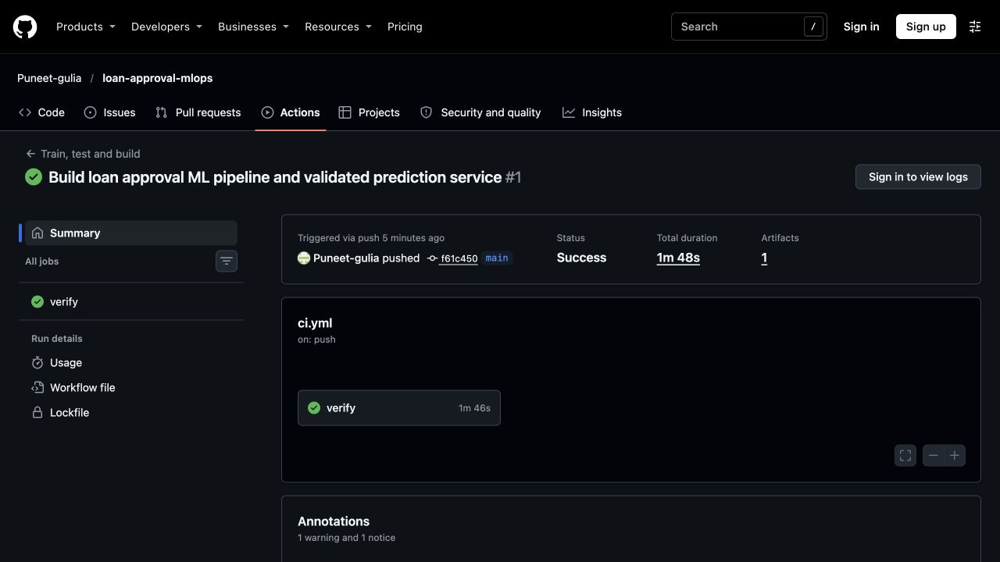
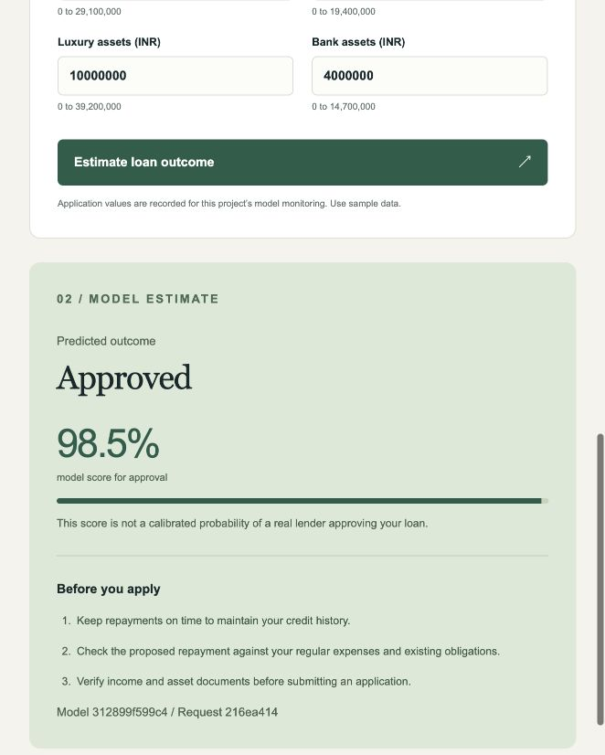
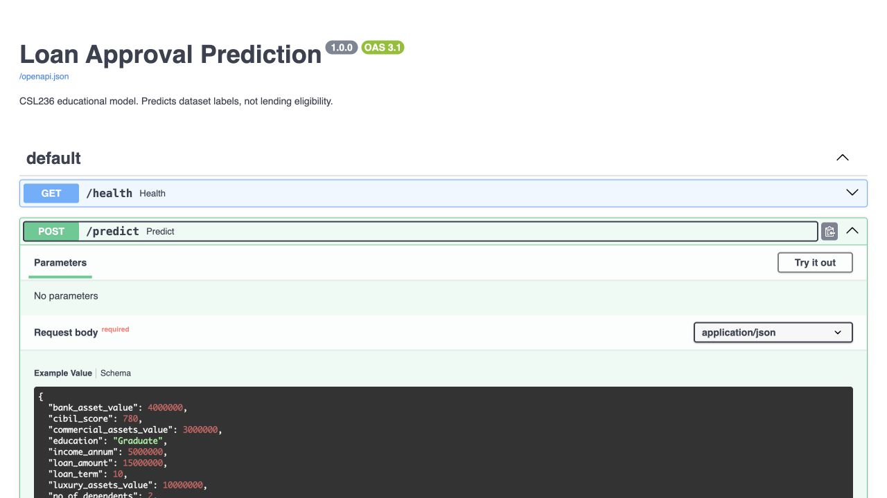
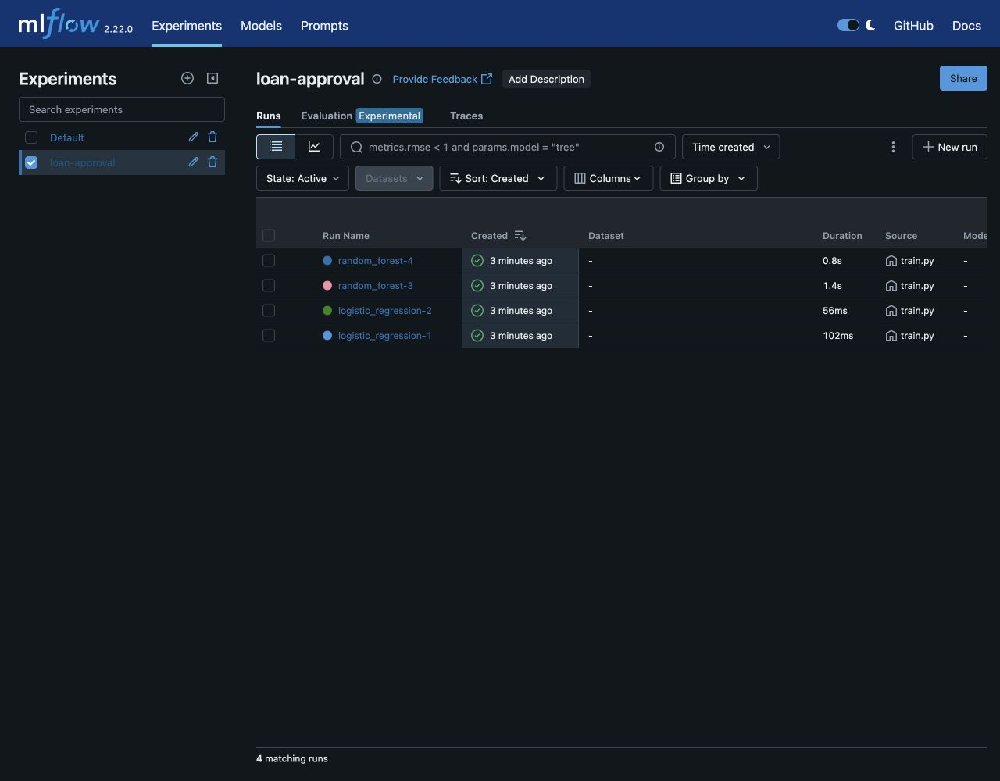
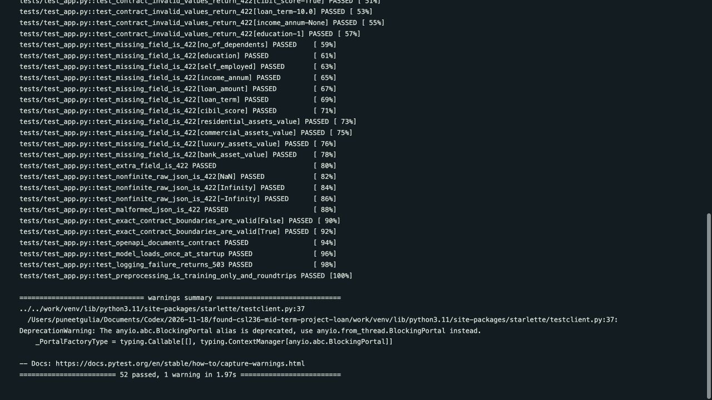

# Loan Approval Prediction

CSL236 end-term project: a reproducible training pipeline and a validated FastAPI application built from the loan approval mid-term notebook.

## Current status

[](https://github.com/Puneet-gulia/loan-approval-mlops/actions/workflows/ci.yml)

**Published:** [GitHub repository](https://github.com/Puneet-gulia/loan-approval-mlops). **Verified:** [GitHub Actions run](https://github.com/Puneet-gulia/loan-approval-mlops/actions/runs/44360621163), 52 passing API/pipeline tests, Docker image build and valid/invalid prediction checks. Container logs survived a restart both locally and in CI. The local Apple Silicon image is 157,453,993 bytes (157.45 MB), and the CI Linux amd64 image is 159,706,078 bytes (159.71 MB).

**Live:** [Loan approval app](https://loan-approval-mlops-w8p2.onrender.com) and [interactive API docs](https://loan-approval-mlops-w8p2.onrender.com/docs). Public checks passed for UI, docs, health, a valid prediction, credit-profile comparison and HTTP 422. The free Render service manages its process lifecycle. **Team:** Gaurav Sethi (24CSU250), Saksham Srivastava (24CSU179), Puneet Gulia (24CSU167), section AI-B. Actual contribution allocations remain to be completed.

## Problem and dataset

Predict the dataset label `loan_status` (`Rejected=0`, `Approved=1`) using 11 applicant inputs. The CSV contains 4,269 rows and 13 columns, including an identifier and target. The model is an educational classifier, not an assessment of real lending eligibility or repayment/default risk.

Dataset attribution: [Archit Sharma, Loan Approval Prediction Dataset, Kaggle](https://www.kaggle.com/datasets/architsharma01/loan-approval-prediction-dataset). The supplied CSV's schema and size match this dataset. The exact download history and underlying real-world provenance have not been independently established. Check the current dataset licence before redistribution. The input CSV and the original notebook were copied unchanged from Downloads. The CSV's SHA-256 is recorded in `model/metadata.json`.

EDA: 2,656 Approved and 1,613 Rejected labels (62.2% / 37.8%). No empty CSV values. There are 28 negative residential asset values (-100,000). Following the mid-term, training treats them as invalid and imputes the training median; an undocumented sentinel is only a hypothesis. The API rejects new negative asset values. `loan_id` is excluded. Asset values are skewed, and credit score strongly separates the supplied labels.

## Data contract

All 11 inputs are required. JSON integer fields are strict: strings, booleans and floating point values are rejected. Extra fields, nulls, and values outside the contract return HTTP 422. Amounts use whole INR. Bounds describe the scope of this demonstration, informed by the supplied data, rather than universal lending rules. Annual income permits 100,000 as a conservative extension below the observed minimum of 200,000. Zero luxury assets is also allowed even though the observed minimum is 300,000. Predictions at such extensions have less empirical support.

| Feature | Type | Allowed range / values | Why it matters |
|---|---|---|---|
| no_of_dependents | strict int | 0 to 5 | Household context |
| education | string enum | Graduate, Not Graduate | Education category |
| self_employed | string enum | Yes, No | Employment category |
| income_annum | strict int | 100000 to 9900000 | Annual income in INR |
| loan_amount | strict int | 300000 to 39500000 | Requested loan in INR |
| loan_term | strict int | 2 to 20, multiples of 2 | Repayment horizon in years |
| cibil_score | strict int | 300 to 900 | Credit history indicator |
| residential_assets_value | strict int | 0 to 29100000 | Residential asset value in INR |
| commercial_assets_value | strict int | 0 to 19400000 | Commercial asset value in INR |
| luxury_assets_value | strict int | 0 to 39200000 | Luxury asset value in INR |
| bank_asset_value | strict int | 0 to 14700000 | Bank asset value in INR |
| loan_status (training target only) | binary label | Rejected=0, Approved=1 | Outcome to predict |

`app.py:LoanRequest` enforces every input rule. The target is excluded from the request; sending it returns 422. This avoids leaking the answer. The response is `Approved` or `Rejected`, with an approval model score, 3 rule-based tips, request ID and model version. The score is not calibrated to real-world approval likelihood.

## Setup and run

Use Python 3.11. Run all commands from this repository root.

```bash
python3.11 -m venv venv
source venv/bin/activate
python -m pip install -r requirements.txt
python train.py --compare
python -m pytest -v --tb=short
uvicorn app:app --host 127.0.0.1 --port 8000
```

Open [the UI](http://127.0.0.1:8000), [OpenAPI docs](http://127.0.0.1:8000/docs) and [health check](http://127.0.0.1:8000/health). A trained artifact is included. Model serialization is trusted-code serialization; only load the project's own joblib artifacts. Keep the pinned scikit-learn version when loading the bundled model.

Training hyperparameters are configurable:

```bash
python train.py --algorithm random_forest --n_estimators 100 --max_depth 6
python train.py --algorithm logistic_regression --C 1.0
mlflow ui --backend-store-uri sqlite:///mlflow.db --host 127.0.0.1 --port 5000
```

`--compare` runs four configurations and overwrites `docs/experiments.csv`, model metadata and model artifacts with the best configuration from that invocation. A single-configuration command promotes that invocation's model, so use `--compare` again before submission if you have run a baseline. Historical runs remain in SQLite. `MLFLOW_TRACKING_URI` can override the default database URI.

## Pipeline and model choice

The train/test split is stratified 80/20 with seed 42 (3,415 / 854 rows), matching the mid-term. Within the training partition, 3-fold stratified cross-validation fits the complete preprocessing pipeline separately per fold. Selection maximizes mean **Rejected-class F1**, then accuracy. Only the selected configuration is evaluated on the holdout. The holdout has already been examined in the mid-term, so its result is not a new external validation.

`LoanFeatures` strips whitespace, replaces invalid residential assets, learns numeric medians and income quartiles, maps binary categories, adds project-defined credit/term/income bands, loan-to-income ratio and total assets, and square-root transforms residential/commercial assets. StandardScaler learns from each fold. All 11 original inputs remain, producing 16 transformed features. Unlike the mid-term's aggressive feature selection/PCA comparison, this end-term retains the original inputs to satisfy the five-feature requirement and compares two algorithms. The credit bands are project design choices, not official CIBIL policy.

Training saves the preprocessing and classifier together in `model/model.joblib`. The API loads that pipeline once per process at startup. MLflow records parameters, validation metrics, data hash and the selected run. Final metrics, confusion matrix, feature importance and model hash are stored in `model/metadata.json`.

## Recorded experiment results

| Run | Algorithm / configuration | CV accuracy | CV Rejected F1 | F1 std |
|---|---|---:|---:|---:|
| 1 (538a768c) | logistic_regression, C=0.1 | 0.9657 | 0.9558 | 0.0088 |
| 2 (d22d58fe) | logistic_regression, C=1.0 | 0.9827 | 0.9774 | 0.0054 |
| 3 (0e921cac) | random_forest, trees=100.0, depth=6.0 | 0.9965 | 0.9953 | 0.0010 |
| 4 (f1e85a81) | random_forest, trees=200.0, depth=10.0 | 0.9965 | 0.9953 | 0.0010 |

**Selected:** Random Forest, 100 trees, depth 6. Both forests tied on the stored CV scores; configuration order breaks the tie in favour of the smaller model. The 200-tree forest showed no measured gain.

Selected model holdout: **accuracy 0.9953, Rejected F1 0.9938, Approved F1 0.9962**. Majority baseline accuracy: 0.6218. Confusion matrix, rows actual and columns predicted, order Rejected/Approved: `[[319, 4], [0, 531]]`.

**Local tests:** 52 passed (one upstream Starlette/AnyIO deprecation warning). See the saved transcript for details.

## Live deployment

- [Application](https://loan-approval-mlops-w8p2.onrender.com)
- [API documentation](https://loan-approval-mlops-w8p2.onrender.com/docs)
- [Health](https://loan-approval-mlops-w8p2.onrender.com/health)
- [PDF report](https://github.com/Puneet-gulia/loan-approval-mlops/blob/main/docs/Loan_Approval_Report.pdf)
- [PowerPoint](https://github.com/Puneet-gulia/loan-approval-mlops/blob/main/docs/Loan_Approval_Presentation.pptx)





The verified service is on Render's free plan. It may sleep after inactivity and take 50 seconds or more to wake. Application logging is active, but free-instance filesystem storage is ephemeral and logs do not survive instance replacement. Local/CI Docker-volume tests verified durable logs across container restarts. No payment or paid plan was selected.

Recheck the deployed endpoints with:

```bash
python verify_service.py --url https://loan-approval-mlops-w8p2.onrender.com
```

## Publication evidence



[Hosted CI run](https://github.com/Puneet-gulia/loan-approval-mlops/actions/runs/44360621163). Downloaded artifacts: `docs/evidence/github-ci/`. These include actual Linux pytest output, container smoke checks and image size. Local build and restart evidence is alongside them.

## API example

```bash
curl -s http://127.0.0.1:8000/predict \
  -H 'Content-Type: application/json' \
  -d '{"no_of_dependents":2,"education":"Graduate","self_employed":"No","income_annum":5000000,"loan_amount":15000000,"loan_term":10,"cibil_score":780,"residential_assets_value":8000000,"commercial_assets_value":3000000,"luxury_assets_value":10000000,"bank_asset_value":4000000}'
```

Change `cibil_score` to 901 to demonstrate HTTP 422. Compare otherwise identical examples with scores 400 and 800 for the domain-logic demonstration. This is a spot check, not a proof of global monotonicity.

## Local screenshots









All captures show local execution. The complete validation response is in `docs/evidence/invalid-422.jpg`. Hosted CI evidence is in `docs/evidence/github-ci.jpg` and [the recorded run](https://github.com/Puneet-gulia/loan-approval-mlops/actions/runs/44360621163). The [live Render deployment](https://loan-approval-mlops-w8p2.onrender.com) is verified. See `docs/evidence/live-verification.json` and the live screenshots.

## Tests and evidence

`tests/test_app.py` covers health, UI/static files, valid predictions, logging, domain behaviour, every field's constraints, missing fields, extra fields, exact boundaries, OpenAPI, one startup load, logging failures and preprocessing serialization. `docs/evidence/pytest.txt` records actual local results. UI and MLflow captures describe local operation. A real green GitHub Actions screenshot and downloaded CI artifacts are included. Live deployment and verification evidence are included in `docs/evidence/live-verification.json`, `deployment.json`, `render-live.jpg`, `live-ui.jpg`, `live-docs.jpg` and `live-422.jpg`.

## Docker

The image uses `python:3.11-slim`, installs only `requirements-serve.txt`, runs as a non-root user and exposes port 8000. It excludes training tools, test tools, raw data, experiment history and documentation from the serving image. Both top-level dependency files pin versions; transitive dependencies are not fully locked.

```bash
docker build -t loan-approval .
docker run -d --name loan-approval -p 8000:8000 --restart unless-stopped -v loan-predictions:/app/logs loan-approval
docker image inspect loan-approval --format '{{.Size}}'
# Or build, persist logs and set restart policy together:
docker compose up --build -d
```

**Measured image sizes:** local linux/arm64: **157,453,993 bytes (157.45 MB)**; CI linux/amd64: **159,706,078 bytes (159.71 MB)**. The image built successfully on both. Local and CI checks verified UI/docs/health, a valid prediction, stronger-vs-weaker credit examples, HTTP 422, and log persistence after restart. Raw records are under `docs/evidence/`.

## CI and deployment

`.github/workflows/ci.yml` runs on pushes to main and pull requests. It installs dependencies, trains a baseline from scratch, runs pytest, builds Docker and probes `/health`. It uploads the image size and training metadata. The first [hosted run passed](https://github.com/Puneet-gulia/loan-approval-mlops/actions/runs/44360621163); the latest status is visible in the badge above.

Deployment option A: a Linux host with Docker. Clone the published repository, build and use `docker compose up --build -d`; allow the service port and terminate HTTPS at the hosting platform or reverse proxy. Restart the host/container once to verify recovery. Mount logs persistently.

Deployment option B: a Docker-capable platform using `render.yaml`. Confirm the platform's current plan, restart and storage behaviour before creating a service. The supplied config does not provision persistent storage. For persistent logs, mount a supported disk and set `PREDICTION_LOG` to its path, or use the Linux Docker volume approach. Ephemeral platform storage loses logs on replacement. A free Docker web service was created on Render: [live application](https://loan-approval-mlops-w8p2.onrender.com). No paid resource was provisioned.

Set `PORT` when a host requires it. `/health` is the health endpoint. `MODEL_PATH` and `PREDICTION_LOG` are configurable. Use one worker for safe file rotation. **Public URL: [https://loan-approval-mlops-w8p2.onrender.com](https://loan-approval-mlops-w8p2.onrender.com).** The service uses the free plan with `/health` and `PORT=8000`. It was created from the public repository at commit `f61c450`; app/model code is unchanged in later documentation commits. A replacement deployment may discard local log files. For durable logs, use a persistent volume on a supporting host. Public-repository services may require a manual deploy for later changes unless Git/Blueprint auto-deploy is configured. Free hosting policies change; no particular service is guaranteed to remain free.

## Monitoring and drift bonus

Each successful prediction records UTC time, all 11 validated inputs, outcome, score, request ID and model version in `logs/predictions.jsonl`. Logs rotate at 5 MB with 3 backups. They contain application attributes and should remain private. Only fictional demonstration inputs are included as evidence in `docs/evidence/sample_predictions.jsonl`.

```bash
python drift_check.py
python drift_check.py --log docs/evidence/sample_predictions.jsonl
```

The drift script reads current and rotated files. With fewer than 30 observations it returns `insufficient_data`. Otherwise it compares raw numeric means/std against the training-only reference. Review flags when mean shift exceeds 0.5 training standard deviations or std ratio falls outside [0.5, 2]. These are heuristic thresholds, not a statistical guarantee of model failure. Drift alone does not prove performance loss. Delayed ground-truth outcomes and subgroup checks would be needed for production.

## Repository layout

```text
data/loan_approval_dataset.csv
model/model.joblib
model/metadata.json
model/reference.json
static/index.html, style.css, app.js
tests/test_app.py
.github/workflows/ci.yml
app.py
preprocessing.py
train.py
drift_check.py
Dockerfile
compose.yaml
render.yaml
requirements.txt
requirements-serve.txt
README.md
mlflow.db
notebooks/TeamNo_MidTermProject.ipynb
docs/experiments.csv
docs/evidence/
```

The extra preprocessing module keeps serialization importable. The original notebook uses its original relative CSV path. To rerun it from notebooks/, update the read path to `../data/loan_approval_dataset.csv`. Its preserved outputs describe the original mid-term, while end-term metrics live in model/metadata.json.

## Limitations

- The dataset has a very sharp credit-score threshold and may reflect constructed decision rules. High accuracy does not establish real-world performance.
- Inputs and labels do not include actual repayment outcomes. Approval classification is different from default prediction.
- The same holdout appeared in the mid-term. Add a new independently collected validation set before claiming generalization.
- No fairness evaluation, probability calibration, authentication or rate limiting is implemented. Use fictional inputs for the demo and keep logs private.
- The schema rejects missing online inputs; historical negative residential values are imputed only during training.
- Numeric limits define a narrow demo scope. New values outside it require a reviewed contract change and validation.
- The API records data for later drift checks. There is no automated retraining or CD step.

## Submission and team details

The 19 November revision includes all three team members and section AI-B, a 10-page report, and a 12-slide editable PowerPoint. GitHub, Docker, CI and live-deployment verification are recorded. Complete actual contribution allocations before submission. Individually named copies matching `Name_RollNo.pdf` and `Name_RollNo.pptx` are included in `docs/submission/`; each contains the same team report/deck. Contributions must reflect actual work and commits; do not attribute generated work to invented team members.

| Member | Roll number | Section | Actual contribution |
|---|---|---|---|
| Gaurav Sethi | 24CSU250 | AI-B | Add actual work and commit evidence |
| Saksham Srivastava | 24CSU179 | AI-B | Add actual work and commit evidence |
| Puneet Gulia | 24CSU167 | AI-B | Add actual work and commit evidence |

Outstanding submission evidence:

- The public repository is published. Each member must still make their own meaningful commits.
- CI and Docker checks passed. Capture the latest run again after any final code changes.
- Docker image size is recorded above with local and CI verification evidence.
- Public `/`, `/docs`, `/health`, valid predictions and invalid-input rejection are verified. Check the service again before the viva, allowing for a free-plan cold start.
- Authentic CI/deployment evidence and public links are included. Preserve the evidence when filling in team information.
- Names, roll numbers and section are included. Complete each member's actual contributions and commit evidence before submission.
- The presentation links page includes working GitHub, live service, `/docs` and hosted report links. Recheck them before submitting.

## References

- Supplied `CSL236_EndTerm_Project_Guidelines.pdf`, sections 2–7.
- Supplied loan approval mid-term notebook, retained under `notebooks/`.
- [Dataset attribution](https://www.kaggle.com/datasets/architsharma01/loan-approval-prediction-dataset).
- [FastAPI lifespan](https://fastapi.tiangolo.com/advanced/events/) for startup model loading.
- [Pydantic strict mode](https://docs.pydantic.dev/latest/concepts/strict_mode/) for validation.
- [MLflow tracking](https://mlflow.org/docs/latest/tracking/) for experiment records.
